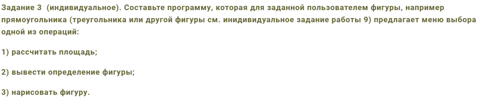
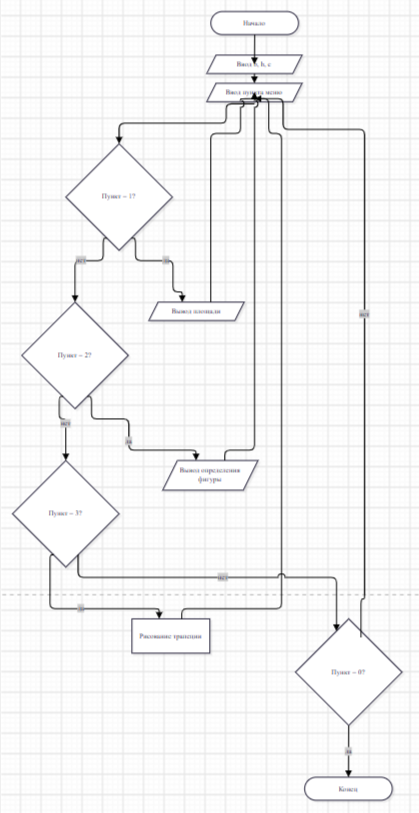

## Домашнее задание к лабораторной 10

### Вариант 11

```
#define _CRT_SECURE_NO_WARNINGS
#include <stdio.h>
#include <locale.h>

// Лабораторная 10, задание 3 (индивидуальное), вариант 11
// Фигура: равнобедренная трапеция (только контур), параметры b, h, c:
// b - верхнее основание, c - нижнее основание, h - высота.
// Меню: 1) площадь  2) определение фигуры  3) нарисовать фигуру

float area_trapezoid(float b, float h, float c);
void print_definition(void);
void draw_trapezoid(int b, int h, int c);

int main()
{
    setlocale(LC_ALL, "Rus");
    int punkt;
    float b, h, c;

    printf("Введите верхнее основание b: ");
    scanf("%f", &b);
    printf("Введите высоту h: ");
    scanf("%f", &h);
    printf("Введите нижнее основание c: ");
    scanf("%f", &c);

    do
    {
        printf("\nМеню:\n");
        printf("1 - рассчитать площадь\n");
        printf("2 - вывести определение фигуры\n");
        printf("3 - нарисовать фигуру\n");
        printf("0 - выход\n");
        printf("Ваш выбор: ");
        scanf("%d", &punkt);

        if (punkt == 1)
            printf("Площадь = %.2f\n", area_trapezoid(b, h, c));
        else if (punkt == 2)
            print_definition();
        else if (punkt == 3)
            draw_trapezoid((int)b, (int)h, (int)c);
        else if (punkt != 0)
            printf("Такого пункта нет\n");
    } while (punkt != 0);

    return 0;
}

// площадь трапеции = (b + c) / 2 * h
float area_trapezoid(float b, float h, float c)
{
    return (b + c) / 2 * h;
}

void print_definition(void)
{
    printf("Равнобедренная трапеция - это четырёхугольник, у которого\n");
    printf("две стороны (основания) параллельны, а две другие (боковые стороны) равны.\n");
}

// рисуем контур символом '*'
// d - на сколько верхнее основание уже нижнего с каждой стороны
void draw_trapezoid(int b, int h, int c)
{
    int i, j, d, left, right;

    if (c < b || (c - b) % 2 != 0 || h < 2)
    {
        printf("Для рисунка нужно: c >= b, разность c - b чётная, h >= 2\n");
        return;
    }
    d = (c - b) / 2;

    for (i = 0; i < h; i++)
    {
        // левая граница в строке i (в первой строке left = d, в последней left = 0)
        left = d - d * i / (h - 1);
        right = c - 1 - left;
        for (j = 0; j < c; j++)
        {
            if (i == 0 || i == h - 1)          // верхнее и нижнее основания
            {
                if (j >= left && j <= right)
                    printf("*");
                else
                    printf(" ");
            }
            else                                // боковые стороны
            {
                if (j == left || j == right)
                    printf("*");
                else
                    printf(" ");
            }
        }
        printf("\n");
    }
}
```

### Вывод
####Я научилась разбивать программу на собственные функции. Для трапеции я написала отдельные функции для площади, для вывода определения фигуры и для рисования контура символом «*». В `main()` остались только ввод данных и меню, которое вызывает нужную функцию. Я поняла, что в функцию значения передаются через параметры, а результат возвращается оператором `return`. Для рисования функция ничего не возвращает, поэтому она объявлена как `void`. Ещё я поняла, что прототип функции нужно писать до `main()`, чтобы компилятор мог проверить типы параметров. Функции удобны тем, что один и тот же код можно вызывать много раз, не копируя его.